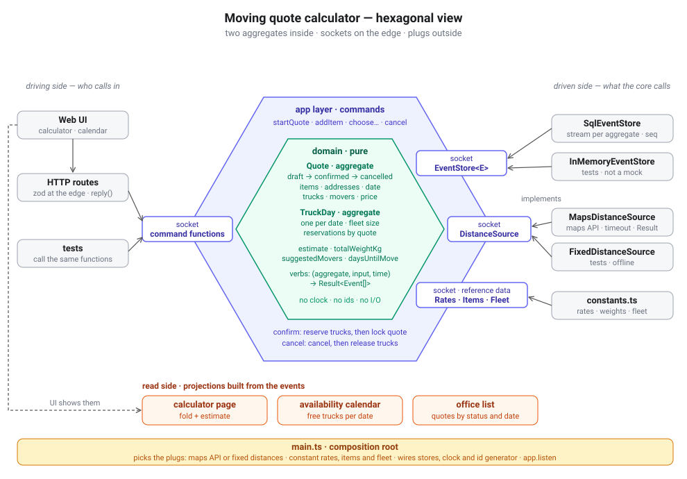
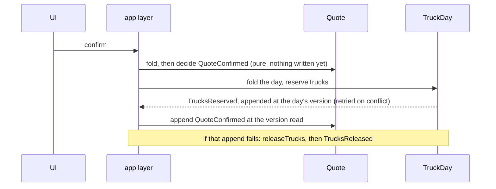

# 2026-11-08 — moving quote calculator: design and build

The first app of the architecture-planning day. Designed in the morning, built
the same day. This file is the whole story: the problem, how the aggregates were
found, the events and verbs, how the two aggregates cooperate, what changed
between the plan and the build, what was verified, and the questions for the
lead. The plan as it was written before the build is in [`plan.md`](plan.md).



## 1. The problem

A customer opens the moving company's page and starts a quote. They pick the
items to move and adjust how much each weighs, give the pickup and delivery
addresses, pick a move date and the number of trucks. The app suggests how many
movers are needed; the customer can change that. A live estimate updates as
they go. Confirming locks the price and books the trucks for that day. A
confirmed move can be cancelled, but not within 7 days of the move.

The four answers that shaped the design:

1. The app works out the movers, but the customer can override them.
2. The estimate is live while drafting; confirming locks it.
3. Truck capacity is shared by every quote and shown on a calendar.
4. Items have default weights, and the customer can edit them.

## 2. Finding the aggregates

The first sketch was one aggregate, `Quote`, one stream, and the events
`quoteCreated`, `itemAdded`, `itemDeleted`. The three questions moved it on:

| Question | Answer |
|---|---|
| Who is it built for? | The customer planning a move, and the office that has to send trucks on the day. |
| What matters to them? | The customer: a price that does not change once confirmed. The office: never promising more trucks on a day than it has. |
| What must stay true? | The "cannot" sentences below. |

| "Cannot" sentence | Whose rule |
|---|---|
| A confirmed quote cannot change. | a quote |
| A move inside 7 days cannot be cancelled. | a quote |
| A day cannot book more trucks than the fleet. | **a day** |

The third sentence is about a day, and every quote for that date shares it. If
each quote kept its own count of free trucks, two customers could both see the
last truck and both confirm. So the day is an aggregate of its own: `TruckDay`,
one per date. Never an aggregate inside an aggregate: the quote knows how many
trucks it *wants*; the day knows who *has* them.

Two names changed from the first sketch:

- `quoteCreated` became `QuoteStarted`. A customer starts a quote; "created" is a database word.
- `itemDeleted` became `ItemRemoved`. Nothing is deleted from an event store; the item is taken off the list, and the event that added it stays.

## 3. The aggregates

### Quote

```ts
interface Quote {
    id: string;
    status: 'draft' | 'confirmed' | 'cancelled';
    lines: { lineNo, item, quantity, weightKg }[];   // weight per unit
    linesAdded: number;                              // the next line is linesAdded + 1
    route: { pickup, delivery, distanceKm } | undefined;
    moveDate: string | undefined;
    trucks: number | undefined;
    moversOverride: number | undefined;              // the customer's choice; wins over the suggestion
    priceCents: number | undefined;                  // set when confirmed: the promise
}
```

Rules it protects:

1. Only a draft can change. A confirmed quote is a promise.
2. Confirming needs at least one item, both addresses, a move date still in the future, the trucks, and enough truck capacity for the total weight.
3. A line can be edited or removed only if it exists.
4. Only a confirmed quote can be cancelled, and only with **more than** 7 days' notice. Exactly 7 is refused.

### TruckDay

```ts
interface TruckDay {
    date: string;                                    // the stream id: one aggregate per date
    reservations: { quoteId, trucks }[];
}
```

Rule it protects: the trucks reserved never exceed the fleet that day. The fleet
size is reference data handed to the verb: 4 trucks, 2 on Sundays.

## 4. Events

Every event carries `at`, the moment it happened, stamped from `Now`.

### Quote stream: `quote-<uuid>`

| Event | Carries | Copied from outside |
|---|---|---|
| `QuoteStarted` | `quoteId` | |
| `ItemAdded` | `lineNo, item, quantity, weightKg` | the weight: the catalogue default, or the customer's |
| `ItemWeightChanged` | `lineNo, weightKg` | |
| `ItemRemoved` | `lineNo` | |
| `AddressesChosen` | `pickup, delivery, distanceKm` | the distance the maps service gave at that moment |
| `MoveDateChosen` | `date` | |
| `TrucksChosen` | `count` | |
| `MoversChosen` | `count` | |
| `QuoteConfirmed` | `priceCents, breakdown, moveDate, trucks` | the price under the rate card of the day |
| `QuoteCancelled` | `moveDate, trucks` | |

### Day stream: `truckday-<YYYY-MM-DD>`

| Event | Carries |
|---|---|
| `TrucksReserved` | `date, quoteId, trucks` |
| `TrucksReleased` | `date, quoteId, trucks` |

Copying values onto the fact is the same idea as `priceCents` on a trade in
portfolio-es. If the catalogue, the maps answer or the rates change next month,
a past quote keeps what it was given.

## 5. Verbs

Every verb is `(aggregate, input, now) => Result<Event[]>`, except
`startQuote`, which has no aggregate yet.

| Verb | Event | Refused when |
|---|---|---|
| `startQuote(quoteId, now)` | `QuoteStarted` | no id |
| `addItem(quote, toMove, catalog, now)` | `ItemAdded` | not a draft; item not in the catalogue; quantity or weight not a positive whole number |
| `changeItemWeight(quote, lineNo, weightKg, now)` | `ItemWeightChanged` | not a draft; no such line; bad weight |
| `removeItem(quote, lineNo, now)` | `ItemRemoved` | not a draft; no such line |
| `chooseAddresses(quote, route, now)` | `AddressesChosen` | not a draft; an address is blank; bad distance |
| `chooseMoveDate(quote, date, now)` | `MoveDateChosen` | not a draft; not a real date; not after today |
| `chooseTrucks(quote, count, now)` | `TrucksChosen` | not a draft; not a positive whole number |
| `chooseMovers(quote, count, now)` | `MoversChosen` | not a draft; not a positive whole number |
| `confirmQuote(quote, rates, now)` | `QuoteConfirmed` | rule 2; the message lists what is missing |
| `cancelQuote(quote, now)` | `QuoteCancelled` | a draft; already cancelled; 7 days or less to the move |
| `reserveTrucks(day, quoteId, trucks, fleetSize, now)` | `TrucksReserved` | not enough free trucks; this quote already holds trucks that day |
| `releaseTrucks(day, quoteId, now)` | `TrucksReleased` | this quote holds nothing that day |

`confirmQuote` and `cancelQuote` return `Result<[OneEvent]>`, a tuple of exactly
one event. The type tells the app layer there is one event to read the date and
trucks from, without an `if`.

The quote numbers its own lines: `lineNo` is one more than the lines added so
far. Pure, deterministic, never reused after a removal, and no id has to be
minted for a line.

## 6. Derived values: computed, never stored

| Function | What it gives |
|---|---|
| `totalWeightKg(quote)` | sum of quantity × weight |
| `suggestedTrucks(quote, rates)` | enough trucks for the weight, at least 1 |
| `suggestedMovers(quote, rates)` | one mover per 400 kg, at least 2 |
| `trucksFor`, `moversFor` | the customer's choice if made, otherwise the suggestion |
| `capacityShortKg(quote, rates)` | how much weight the chosen trucks cannot carry |
| `estimate(quote, rates)` | the breakdown, plus the parts still missing before confirming |
| `freeTrucks(day, fleetSize)` | fleet minus reservations |

The estimate is recalculated on every screen while the quote is a draft. Only
`QuoteConfirmed` turns it into a fact.

```
hours    = max(2, ceil(weight / (movers × 150 kg)))
price    = base fee + trucks × truck fee + trucks × km × per-km fee + movers × hours × hourly rate
```

| Rate card (constants for now) | |
|---|---|
| base fee | $99 |
| per truck | $150 |
| per km, per truck | $2 |
| per mover-hour | $45 |
| a mover moves | 150 kg an hour |
| truck capacity | 3,000 kg |
| minimum | 2 movers, 2 hours |

## 7. Across two aggregates: confirm and cancel

One append per aggregate, so confirming and cancelling are small processes in
the app layer. The order is chosen so that a failure halfway errs on the safe
side: **a truck held too long is safe; a confirmed quote with no truck is not.**



Cancel runs the other way round. The 7-day rule lives in the quote, so the
quote is cancelled first, then the trucks are released. If the release fails,
the trucks stay held: unavailable, never double-booked.

**Expected version on append, from day one.** `append(stream, expectedSeq,
events)` refuses a write if the stream moved since it was read. Two customers
reserving the last truck at the same moment would both fold "1 free" and both
append. The second append is refused; the app layer re-reads the day, decides
again against the truth, and gets "only 0 truck(s) free". The day stream
retries up to 3 times because conflicts there are expected. The quote stream
does not retry: a conflict there means the customer changed the quote in
another window, and they are told to reload.

In portfolio-es expected version was an open question. Here it is what makes
the `TruckDay` invariant true.

## 8. Time

```ts
interface Now {
    at: string;      // ISO-8601 UTC: stamped on events
    today: string;   // YYYY-MM-DD in the company's time zone: what date rules compare against
}
```

The domain never reads a clock. `main.ts` makes both parts; tests hand in a
fixed `Now`. The 7-day rule compares calendar dates (`daysBetween(today,
moveDate)`), not timestamps, so it counts days on the company's calendar, not
24-hour periods. The time zone is `COMPANY_TZ`, or the machine's when unset.

## 9. Sockets and plugs

| Socket (domain) | Plugs | Used by |
|---|---|---|
| `EventStore<E>`: `read`, `append` with expected seq | `SqlEventStore`, `InMemoryEventStore` | commands |
| `EventFeed<E>`: `readAll` in the order things happened | the same two classes | projections |
| `DistanceSource`: `distanceKm(pickup, delivery)` | `FakeMapsDistanceSource`, `FixedDistanceSource` | `chooseAddresses` |
| `ReferenceData`: catalogue, rate card, `fleetSize(date)` | `constants.ts` | commands, projections |
| clock and ids | `main.ts` | `Deps.now`, `Deps.newId` |

The fake maps plug behaves like a real one at the socket. It waits a little,
gives the same distance for the same two addresses in either order, and fails
as a value for an unknown address. Swapping in a real maps API means writing
one new plug; nothing else changes.

## 10. Read side

| Screen | Projection | Built from |
|---|---|---|
| calculator page | `quoteView` | one quote's events: fold, estimate, suggestions, capacity, last day to cancel |
| availability calendar | `calendar` | all day events: free trucks per date for 28 days |
| office list | `officeList` | all quote events: one row per quote, newest first |

Projections are pure: events in, view out. They fold the whole feed on every
request, which is fine at this size.

## 11. The layers

```
src/
  domain/            pure: quote.ts, truckDay.ts, sockets, time, Result
  commands/          app layer: load → verb → append; confirm and cancel processes
  projections/       read side
  storage/  maps/  reference/      plugs
  http/app.ts        routes, zod at the edge, one reply()
  main.ts            composition root
public/index.html    the UI
```

The domain imports only zod and its own files. A grep finds no clock, no
`randomUUID`, no `fetch`, no `node:` import, no `console`, no `process` and no
import from an outer layer in `src/domain`. `time.ts` uses `Date` only to do
arithmetic on the dates it is given.

## 12. Plan versus build

| The plan said | The build has | Why |
|---|---|---|
| `pickup?, delivery?, distanceKm?` | one `route` | They arrive together on one event; there is never one without the others. |
| nothing for line numbers | `linesAdded` on the quote | Needed so a removed number is never reused. |
| `QuoteConfirmed { priceCents, breakdown }` | also `moveDate, trucks` | The app layer reserves exactly what was confirmed, read off the fact. |
| `QuoteCancelled` with nothing | `moveDate, trucks` | The release reads off the fact which day to free. |
| confirm: "check confirmable", reserve, then `confirmQuote` | `confirmQuote` decides once, up front; the same event is appended after the reservation | One decision, no separate check function to keep in step with it. The version check guards the gap. |
| `daysUntilMove(moveDate, now)` | `Now { at, today }` and `daysBetween` | The 7-day rule needs the company's calendar date, not a timestamp. |
| `MapsDistanceSource` | `FakeMapsDistanceSource` | A fake for now, as asked. |
| `EventStore<E>` only | plus `EventFeed<E>` | Commands read one stream; projections read everything in order. Two needs, two sockets, one class implements both. |
| `RateCard, ItemCatalog, Fleet` | `ReferenceData { catalog, rates, fleetSize(date) }` | The fleet depends on the date. |
| rules 1 to 4 | plus: a draft cannot be cancelled; one reservation per quote per day; a date that passed blocks confirming | Found while writing the verbs and their tests. |

## 13. What carried over from the brokerage, and what is new

Carried over from portfolio-es:

- Verbs are `(aggregate, input, now) => Result<Event[]>`, named as business verbs; events are past-tense facts.
- The fold takes only events, and the id comes from the events.
- Interfaces live in the domain, plugs outside, and `main.ts` picks the plugs.
- Values from outside are copied onto the fact.
- Second plugs instead of mocks, and one contract test that runs against both stores.
- zod parses only at the edges: HTTP bodies, and payloads read back from storage. The event schemas live in the domain, next to the events they describe.
- `Stored<E> = E & { seq }`, and compensation instead of deletion.

New here:

- Two aggregates and a process across them in the app layer.
- Expected version on append, with retries on the contested stream.
- `Now { at, today }`.
- The aggregate assigns its own line numbers.
- The read socket, `EventFeed<E>`, is separate from the write socket.

## 14. Verified

Over HTTP:

| Action | Result |
|---|---|
| 2 sofas and 20 boxes at 18 kg, 4 trucks, move in 20 days | confirmed at $2,599.00 |
| a second quote for the same day | refused: "only 0 truck(s) free on 2026-11-28" |
| cancel the first quote, 20 days out | cancelled, trucks released |
| confirm the second quote again | confirmed at $691.00; calendar shows 3 of 4 free |
| change a confirmed quote | refused: "the quote is confirmed and can no longer change" |
| unknown item, unknown address, confirming too early | refused with the reason; confirming early lists what is missing |

In the browser: started a quote, added 2 sofas and 15 boxes, the fake maps gave
215 km, picked 20 November and 1 truck, and confirmed at $859.00. No console
errors.

## 15. Tests: 42, no mocks

| File | Tests | What they prove |
|---|---|---|
| `quote.test.ts` | 21 | items and line numbers, dates, the estimate, confirm and capacity, cancelling at 8, 7 and 6 days, date arithmetic |
| `truckDay.test.ts` | 5 | reserve within the fleet, the last truck, one hold per quote, release, the fold |
| `commands.test.ts` | 8 | the full flow; the shared fleet; a competitor booking between our read and write; trucks handed back when locking fails; cancel frees trucks; 7 days refused; a stale write refused |
| `eventStore.contract.test.ts` | 4 × 2 stores | empty streams, seq from 1, a stale version refused and nothing written, the feed in order |

Two small store plugs inside the command tests simulate the world misbehaving.
`CompetitorGetsThereFirst` slips another customer's reservation in before ours,
so the store raises a real conflict. `AnotherWindow` refuses the confirm append,
which proves the trucks are released.

## 16. Known gaps

1. If releasing trucks after a cancellation fails three times, the quote is cancelled and the trucks stay held. That is safe, but someone has to release them by hand. A reconciling job is the follow-up.
2. Projections fold every event on each read. Checkpointed projections when that gets slow.
3. Abandoned drafts stay forever.
4. One truck type; the fleet is a constant per weekday.

## 17. Questions for the lead

1. `TruckDay`, one aggregate per date: the right noun, or should it be a `Fleet` aggregate?
2. Reserve first, then lock the quote, with `TrucksReleased` as compensation: do you agree with the order?
3. Confirm decides `QuoteConfirmed` before reserving and appends it after. Is "decide early, write late" fine when the version check guards the gap?
4. `QuoteConfirmed` and `QuoteCancelled` repeat `moveDate` and `trucks` from earlier events. Right, or should the app layer read them from the folded quote?
5. Is the breakdown on `QuoteConfirmed` a fact worth keeping, or only the total?
6. The distance is recorded when the addresses are chosen. Right, or fetch it again at confirm?
7. A release that keeps failing after a cancel: a reconciling job, or something the office list should flag?
8. Single truck type for now, types later as a new event version?
9. Abandoned drafts: leave them, or a `QuoteExpired` event after N days?

## Run

```
npm install
npm run dev        # http://localhost:3100, reloads on save
npm test
npm run typecheck
```
